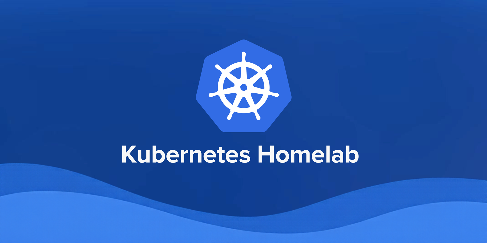

# Homelab



This is the repository for my homelab that uses Kubernetes.

I've decided to move from [Komodo](https://komo.do/) to k8s in order to learn more about technologies commonly used in DevOps and automation. The goal is to have an environment where I can test and break things. I'm almost done transitioning all my services from Komodo to this new format.

I currently have a cluster running on a single VM with k3s, but I do plan on making a declarative setup with Terraform and Talos in the near future.

This repository is set up with GitOps in mind using Flux. Secrets are handled with SOPS and age.

## Repository Structure

```txt
/apps - All applications that I want to run are here
/clusters - Setup for flux and to integrate all folders
/docs - Information on common procedures
/infrastructure - Configuration for cert-manager, traefik, cnpg, etc...
/monitoring - Monitoring stack with kube-prometheus-stack
/provisioning - Reserved for Terraform
/scripts - Helper scripts for automation
/tunnels - A place to store cloudflare tunnel files. Contents are gitignored.
```

## Hardware

I have Proxmox installed on a Beelink S12, which has the following specs:
- Intel Alder Lake N100 12th gen, 3.4GHz, 4 cores, 4 threads
- Intel UHD Graphics 750MHz
- 16GB DDR4 3200MHz
- 500GB SSD

## Feedback

Feel free to use this as an inspiration for your own projects. If you have any suggestions, don't be afraid to get in touch and let me know your thoughts.